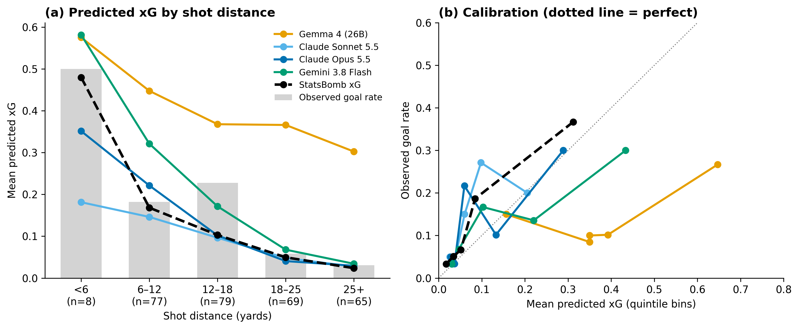

# Can Vision-Language Models Estimate Expected Goals? A Benchmark Against Statistical xG

Houman Kamran Habibkhani, University of the Pacific
Hootan Kamran Habibkhani, Northeastern University

Submitted to the MIT Sloan Sports Analytics Conference 2027 Research Paper Competition (Soccer track), October 1, 2026.

**Introduction.** Expected goals (xG) is football's standard measure of chance quality, informing recruitment, player valuation, and match analysis. Clubs, media, and vendors are adopting general-purpose vision-language models (VLMs) to interpret match situations, yet whether their probability judgments are reliable enough to inform decisions is untested. We ask: from an image of the shot situation alone, how well do current VLMs estimate xG, and where do they systematically diverge from established models?

**Methods.** Using StatsBomb open data from the 2022 FIFA World Cup (1,430 non-penalty shots with freeze frames; 152 goals), we rendered each freeze frame (shooter, teammates, opponents, goalkeeper) as a half-pitch image, with no body part or play context. Four VLMs, one open-weight (Gemma 4, 26B, run locally) and three frontier (Claude Sonnet 5.5, Claude Opus 5.5, Gemini 3.8 Flash), received one standardized zero-shot prompt requesting a goal probability and a one-sentence rationale. All models were scored on the same 298 randomly sampled shots (42 goals) against StatsBomb's commercial xG and a four-feature logistic baseline (distance, angle, header, defenders in the shooting cone) trained with match-grouped cross-validation. We report AUC, Brier score, calibration, paired bootstrap confidence intervals, and disagreement by distance.

**Results.** Performance varied widely by model. AUC rose from 0.60 (Gemma) to 0.68 (Sonnet) and 0.72 (Opus and Gemini), against 0.79 for StatsBomb and 0.77 for the baseline, while Brier scores fell from 0.190 to 0.111 (StatsBomb 0.100) (Table 1). Every VLM was significantly less accurate than StatsBomb, but Opus was statistically indistinguishable from the simple baseline (Brier difference +0.005, 95% CI −0.002 to +0.013). Opus and Gemini ranked chances equally well but missed the overall scoring level in opposite directions (mean 0.11 and 0.17 against an observed 0.14 in this goal-rich sample; 0.11 across all shots), while Gemma averaged 0.38. Errors concentrated on short-range chances (Figure 1a). At 6–12 yards (77 shots), where 18% were scored and StatsBomb averaged 0.17, model averages ranged from 0.15 (Sonnet) to 0.32 (Gemini) and 0.45 (Gemma), while frontier models agreed closely with StatsBomb beyond 18 yards. Rationales exposed the mechanism: models called 7–11-yard attempts "point-blank," while others described high-xG close-range shots as having "very tight" angles.

**Conclusion.** The best frontier VLM now matches a simple statistical xG model from an image alone, but VLMs are not decision-grade: their errors are model-specific and largest on the high-value chances that decide matches. Organizations adopting AI tools should validate and recalibrate VLM outputs against statistical baselines rather than use raw probabilities. Our open benchmark (https://github.com/whotank/vlm-xg-benchmark) supports such evaluation. Next steps include broadcast video, recalibration, and a hybrid design in which VLMs extract geometric features for a calibrated statistical model.

**Table 1.** Performance on 298 World Cup 2022 shots (42 goals; observed goal rate 0.141). Brier difference is relative to the logistic baseline; negative values would indicate better performance.

| Model | AUC | Brier | Mean xG | Brier vs baseline [95% CI] |
|---|---|---|---|---|
| Gemma 4 (26B) | 0.597 | 0.190 | 0.379 | +0.084 [+0.059, +0.111] |
| Claude Sonnet 5.5 | 0.683 | 0.121 | 0.085 | +0.015 [+0.004, +0.027] |
| Claude Opus 5.5 | 0.721 | 0.111 | 0.109 | +0.005 [−0.002, +0.013] |
| Gemini 3.8 Flash | 0.721 | 0.116 | 0.167 | +0.010 [+0.001, +0.020] |
| Logistic baseline | 0.768 | 0.106 | 0.108 | |
| StatsBomb xG | 0.792 | 0.100 | 0.100 | |

**Figure 1.** Four VLMs vs. StatsBomb xG on 298 World Cup 2022 shots. (a) Mean predicted xG by shot distance; gray bars show observed goal rates. VLM errors concentrate at short range and differ in direction by model. The elevated observed rate at 12–18 yards reflects sampling variation, and all models, including StatsBomb, sit below it. (b) Calibration by predicted-xG quintile; the dotted line marks perfect calibration. Small bin sizes (42 goals in total) make individual points noisy.
